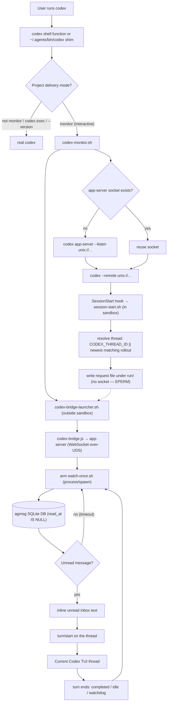

# Codex Monitor

Codex does not expose Claude Code's Monitor tool. agmsg's Codex monitor
approximates the same experience by launching Codex through an app-server bridge.

> ⚠️ **This changes how Codex starts — read before enabling.**
> Enabling monitor mode prints a shell function that makes `codex` route through
> agmsg's monitor shim in your interactive shell. In monitor-mode projects the
> shim re-routes interactive launches through an app-server bridge; everywhere
> else it passes straight through. **Only enable this if you are comfortable with
> the `codex` command being intercepted in that shell.** It depends on Codex
> app-server behavior and may need updating as Codex changes. Known limitations:
> enabling monitor takes effect only after you **restart Codex and send your
> first message** — the SessionStart hook fires on the first turn, not the
> moment Codex opens, so the bridge is absent until you interact once; an
> already-running session stays unmonitored until you restart it (#151); the
> bridge is not torn down when you close the TUI (orphans linger until reboot
> or `mode off`/manual kill, see #149).

## Quick Start

Enable monitor mode in a project:

```bash
~/.agents/skills/agmsg/scripts/delivery.sh set monitor codex "$PWD"
```

The command:

1. Enables agmsg's Codex SessionStart/SessionEnd hooks for the project.
2. Prints a shell function that routes interactive `codex` launches through the
   monitor shim.

The Codex sandbox must allow writes to the installed skill's runtime state:

```text
~/.agents/skills/<cmd>/db
~/.agents/skills/<cmd>/teams
~/.agents/skills/<cmd>/run
```

`install.sh` and `install.sh --update` add these writable roots to
`~/.codex/config.toml` when that file exists.

Add the printed function to your shell profile. It looks like:

```bash
codex() {
  ~/.agents/skills/agmsg/scripts/drivers/types/codex/codex-shim.sh "$@"
}
```

Restart the shell, then launch Codex normally:

```bash
codex
```

In monitor-mode projects, the function routes interactive Codex launches through
the bridge. Outside monitor-mode projects, it passes through to the real Codex.

## Windows: native lifecycle hook queue

Codex's Windows sandbox can reject MSYS shared-memory creation with
`CreateFileMapping ... Win32 error 5`. SessionStart and SessionEnd therefore
use a native PowerShell `commandWindows` that writes a request to
`run/hook-queue/`. A dispatcher started from a normal, unsandboxed terminal
executes the installed Bash hook later. Linux/macOS use the existing `command`;
Claude Code and Codex Stop/PostToolUse retain their existing synchronous hooks.
Queue transport does not repair a sandbox's inability to run those synchronous
hooks or other Bash tools.

### Install or update

Use a checkout containing this feature. In a normal Git Bash terminal, run
`bash ./install.sh --cmd agmsg` for a new installation, or
`bash ./install.sh --update --cmd agmsg` for an existing one. The installer
preserves DB/team state, but can update skill/configuration files and add Codex
writable roots; review and back up existing configuration before using it.
An update downloaded from a different upstream revision may replace this feature.

For an existing installation, stop its dispatcher before updating its scripts.
Then regenerate this project's hooks in Git Bash (outside Codex):

```bash
~/.agents/skills/agmsg/scripts/delivery.sh set monitor codex "$PWD"
```

Check `.codex/hooks.json`: only SessionStart/SessionEnd `commandWindows` should
invoke `hook-enqueue.ps1`; their POSIX `command` values still invoke the existing
session hooks. Other applications' hook entries are preserved.

### Start, inspect and stop

In a **normal PowerShell terminal outside Codex**, set the installed script path
and the exact project directory, then start the dispatcher:

```powershell
$dispatcher = "$env:USERPROFILE\.agents\skills\agmsg\scripts\windows\hook-dispatcher.ps1"
& $dispatcher -Action Start -Project 'C:\work\my project'
& $dispatcher -Action Status
```

Use `-Project @('C:\work\one', 'C:\work\two')` for several explicitly trusted
projects. `-Bash 'C:\Program Files\Git\bin\bash.exe'` overrides Git Bash
(`GIT_BASH`, then `AGMSG_BASH`, then that default path). `-Action Run` runs in
the foreground; `-Once` drains the current queue once. Windows PowerShell 5.1
and PowerShell 7 are supported. If local execution policy prevents running a
script, invoke `powershell.exe -NoProfile -ExecutionPolicy Bypass -File` with
the script path and arguments; this affects that process only.

The dispatcher starts a hidden process for this login only. It does not register
a scheduled task, modify ACLs, change execution policy persistently, or disable
the Codex sandbox. Restart it after logout/reboot. Stop and restart to change
the allowed project list; starting again while it is running keeps the original
list. Run `-Action Status` to confirm startup; a launch message alone is not a
readiness check.

```powershell
& $dispatcher -Action Stop
& $dispatcher -Action Status
```

Stop is cooperative: the current hook completes or times out before shutdown
(default hook deadline 60 seconds, configurable with `-HookTimeoutSeconds`,
plus up to 5 seconds to terminate a timed-out process tree).
The exclusive installation lock prevents concurrent dispatchers and releases
automatically when the process exits. Stop never kills a PID read from a file.

Finally use the Git Bash function from Quick Start, or run
`~/.agents/skills/agmsg/scripts/drivers/types/codex/codex-monitor.sh` directly
from a normal Git Bash terminal in the project. A plain PowerShell `codex`
command does not acquire a Git Bash shell function. Restart Codex, send the
first message, and register the intended team/agent for that session using the
usual agmsg workflow. Inspect `delivery.sh status codex "$PWD"` for the existing
bridge's status. A completed enqueue or hook is not proof of a live bridge or
message delivery; verify an incoming message in the intended Codex thread.

### Diagnostics, retries and rollback

- `run/hook-dispatcher.log` records request IDs, hook exit codes and errors;
  it resets after 1 MiB. The dispatcher does not log stdin or hook stdout;
  hook stderr is retained and may contain context. Enqueue failures also print
  to stderr and append to `%TEMP%\agmsg-hook-enqueue.err`; the hook still exits 0.
- While the dispatcher is stopped, `.req` files stay pending. There is no
  project-local fallback queue: allow writes to this installation's `run/`
  using the existing Codex writable-root configuration. A blocked queue is a
  diagnostic failure, not successful delivery.
- `.done` means the fixed hook exited 0; `.failed` retains rejected/failed
  input; `.processing` becomes `.uncertain` after an interrupted dispatcher.
  Terminal files deduplicate the same request ID. None are automatically
  retried: a hook can perform side effects before failing. After diagnosing a
  failure and checking delivery did not already occur, stop the dispatcher and
  rename the selected `.failed`/`.uncertain` file back to `.req` to retry it.
  Retained requests include raw hook input; protect them as local session data.
  Archive/remove terminal files only while stopped and after the deduplication
  history is no longer needed; storage is not automatically pruned.
- `delivery.sh set off codex "$PWD"` removes this install's delivery hooks and
  stops its bridge through the existing cleanup path. A later queued event is
  rejected if the corresponding monitor hook is absent. `turn` likewise removes
  queue hooks; synchronous Stop/PostToolUse behavior is retained. Stop the
  dispatcher separately when no project needs it.
- To roll back, disable monitor, stop the dispatcher, reinstall the previous
  known revision, and regenerate the desired delivery mode. Preserve DB/teams;
  keep or archive pending/failed requests for diagnosis. The previous revision's
  Windows hooks can encounter the original MSYS sandbox failure again.

### Trust boundary

Allow only projects you trust. The dispatcher accepts exactly Codex lifecycle
events, validates absolute local paths, rejects junctions/symlinks, checks the
current project hook configuration, and invokes a fixed installed replay script.
It accepts no command, script path, endpoint or general environment map from a
request. Session IDs and seat keys are bounded data; the seat's existing record
must match the project's hash. The original stdin is replayed as UTF-8, without
rollout guessing that could select a newer session after a queue delay. Existing
seat/role/bridge association continues to decide which inbox reaches which thread.

This is an explicit sandbox boundary crossing for these fixed hooks, running as
the logged-in user. Keep installed **scripts** outside sandbox-writable roots;
grant runtime writes only to the existing `db`, `teams`, and `run` directories.
A writable source checkout is unsuitable as the trusted dispatcher installation.
The queue and existing runtime records are writable by the session: validation
is not authentication, and a writer can forge permitted events, suppress work,
or fill the queue. Do not use this transport as isolation from malicious code
with access to those runtime roots. No ACL or MSYS shared-memory relaxation is
needed.

## Optional PATH Shim

If you prefer the previous global PATH shim setup, install it explicitly:

```bash
~/.agents/skills/agmsg/scripts/drivers/types/codex/codex-shim-install.sh install
```

Then put `~/.agents/bin` before the real Codex binary on PATH:

```bash
export PATH="$HOME/.agents/bin:$PATH"
```

If `~/.agents/bin/codex` already exists and is not the agmsg shim, agmsg leaves
it untouched. You can either move that command aside and run the install command
again, or launch monitor sessions explicitly:

```bash
~/.agents/skills/agmsg/scripts/drivers/types/codex/codex-monitor.sh
```

For custom command names, replace `agmsg` with the installed skill name:

```bash
~/.agents/skills/<cmd>/scripts/drivers/types/codex/codex-monitor.sh
```

## What The Shim Does

The shell function and optional PATH shim only wrap interactive Codex TUI
launches:

```bash
codex
codex resume
codex "fix this bug"
```

Noninteractive subcommands pass through to the real Codex binary:

```bash
codex exec ...
codex app-server ...
codex login
codex logout
codex plugin ...
```

The shim also passes through when the current project is not in Codex monitor
mode.

## Bridge Mechanics

`codex-monitor.sh` starts (or reuses) an agmsg-managed Codex app-server socket
under `~/.agents/skills/<cmd>/run/`, starts the out-of-sandbox bridge launcher,
and then connects the Codex TUI to that socket with `--remote`.

Codex fires the SessionStart hook on the session's **first turn** (the first
message you send), not the moment the TUI opens — so the bridge does not exist
until you interact once after a restart.

The SessionStart hook is designed to **not** start the bridge directly — a
hook-launched process was observed to run inside the Codex sandbox and fail to
connect to the unix socket (EPERM). Instead:

> Note: this EPERM-avoidance design (the launcher + request-file rendezvous
> below) is under review — in practice the hook has been seen to launch a
> detached bridge directly and connect fine, suggesting the launcher layer may
> be redundant. See #153.

1. `session-start.sh` (the hook) resolves the thread id — `CODEX_THREAD_ID` when
   set, otherwise the newest Codex rollout whose `session_meta` cwd matches the
   project (fresh / `codex exec` sessions never export `CODEX_THREAD_ID`) — and
   writes a **request file** under `run/` (it never touches the socket).
2. `codex-bridge-launcher.sh`, started by `codex-monitor.sh` **outside** the
   sandbox, reads the request file and starts `codex-bridge.js`.
3. The bridge connects to the same app-server over **WebSocket-over-UDS**,
   resumes the thread, and arms `watch-once.sh` via the app-server `process/spawn`
   API (which polls the agmsg DB for unread rows, `read_at IS NULL`).
4. On an unread message it inlines the text into a `turn/start` on that thread —
   surfacing it in the live Codex TUI — then re-arms after the turn ends.

Turns are serialized (one per thread): a message that arrives while a turn is
running stays unread and is delivered after the turn completes. The turn ends
via `turn/completed`, a `thread/status` idle, or a watchdog (the real app-server
does not reliably send `turn/completed`); only then is the next `watch-once`
armed. If a turn does not consume the unread message, the same `max_id` reappears
and the bridge stops instead of looping.



## Worker Guardrails

> ⚠️ **Never poll agmsg by launching a full Codex/Claude session on a short
> interval.** Use a shell-only gate first and start the heavy agent only when
> there is actually something to handle.

### Case study: empty-poll OOM (#163)

A user wired an autonomous worker as a `cron` job (`FREQ=MINUTELY;INTERVAL=3`)
that launched a **full Codex session every 3 minutes** to check the agmsg inbox,
git state, GitHub issues, and so on. The approval/away-window had already
expired, so almost every tick returned `No new messages.` — yet each tick still
spun up a complete Codex session with a long prompt and project context.

About 60 Codex sessions were created in under three hours. Codex Desktop keeps a
transcript / trace / tool-output / local log DB per session, so the no-op runs
accumulated: `~/.codex/logs_2.sqlite` grew to ~2.2 GB (plus ~1.1 GB WAL), Codex
memory climbed to ~158 GB, and macOS hit a Low-Memory / jetsam state that forced
a hard restart.

This is **not** an agmsg transport or SQLite bug. The root cause is the worker
shape: a short-interval scheduler that runs a heavyweight agent as the poller,
with no cheap no-op path, so empty inboxes still pay the full cost — and Codex
Desktop's per-session UI/log accumulation amplifies it.

### Gate with `watch-once.sh`, launch the agent only on a hit

agmsg already ships the cheap gate this needs. `watch-once.sh` is a shell-only,
one-shot inbox oracle — no agent, no Codex turn. It is the same primitive the
Codex monitor bridge uses (see [Bridge Mechanics](#bridge-mechanics)) to avoid
starting a turn on an empty inbox.

```text
exit 0  unread inbound exists   (prints: status=pending count=<n> max_id=<id>)
exit 2  nothing pending          (prints: status=timeout)
exit 1  configuration / runtime error
```

Two-stage worker — the shell gate decides whether the expensive agent runs:

```bash
#!/usr/bin/env bash
set -euo pipefail
SKILL=~/.agents/skills/agmsg/scripts
PROJECT="/path/to/project"

# 1. Cheap shell-only check. --timeout 0 makes it a single poll, then exit.
#    --team/--name scope the gate to one identity (matches the single-flight
#    key below, and disambiguates when the same agent name exists in two teams).
if "$SKILL/watch-once.sh" "$PROJECT" codex --team myteam --name myagent --timeout 0; then
  # 2. Unread exists — only now pay for a full Codex/Claude session.
  codex exec "Handle the new agmsg messages for this project."
fi
# exit 2 (nothing pending) falls through and the worker ends cheaply.
```

### Defense in depth

For an unattended worker, layer these on top of the gate:

- **Single-flight lock per `(team, agent)`** so overlapping ticks don't stack
  concurrent agents:
  ```bash
  exec 9>"/tmp/agmsg-worker.myteam.myagent.lock"
  flock -n 9 || exit 0   # another tick is still running; skip this one
  ```
- **Approval / away-window expiry check before launch.** If the worker is only
  authorized for a window, verify it hasn't expired *before* starting the agent,
  and disable the worker (or exit) once it has — don't leave it `ACTIVE` past its
  window.
- **Exponential backoff on repeated no-ops.** After N consecutive empty gates,
  widen the interval so an idle worker stops hammering.
- **Max-run cap.** Bound total runs (e.g. `COUNT` for `cron`) and prefer
  intervals measured in minutes, not seconds.
- **Codex Desktop note.** Codex Desktop retains transcript / tool-output / trace
  per session and a local log DB (`~/.codex/logs_*.sqlite`). Even short no-op
  sessions accumulate there, so a high-frequency spawner is far heavier than the
  per-run wall-clock suggests. The shell gate above avoids creating those
  sessions at all on empty ticks.

### Emergency stop (runaway worker)

1. Make the worker inactive / unschedule the `cron` job so it stops spawning.
2. Back off delivery: `delivery.sh set turn codex "$PROJECT"` (or `off`) to stop
   monitor-driven launches.
3. Kill stale monitors / spawned sessions and any orphaned bridge
   (`mode off` tears the bridge down; see #149).
4. Inspect Codex Desktop log-DB bloat: `~/.codex/logs_*.sqlite` and its WAL.

## Related Details

- [Delivery modes](../README.md#delivery-modes)
- [Codex bridge implementation](../scripts/drivers/types/codex/codex-bridge.js)
- [Monitor launcher](../scripts/drivers/types/codex/codex-monitor.sh)
- [Codex shim](../scripts/drivers/types/codex/codex-shim.sh)
